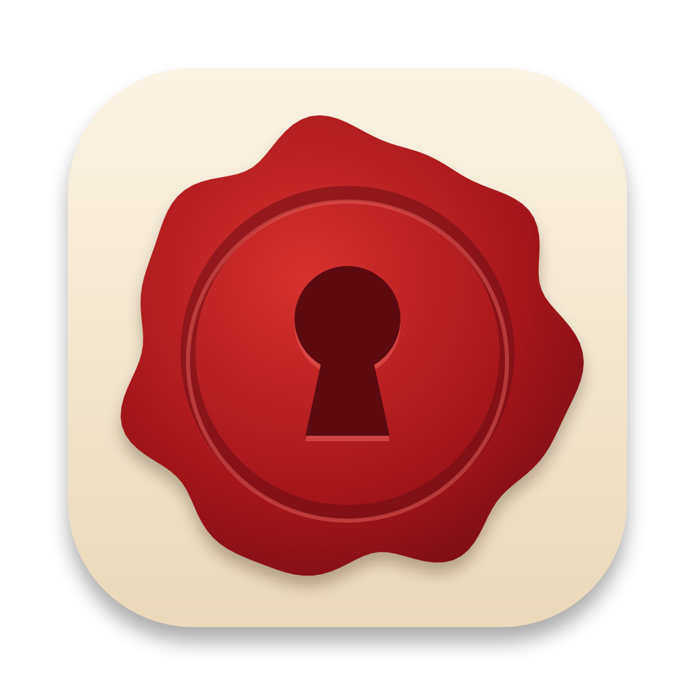
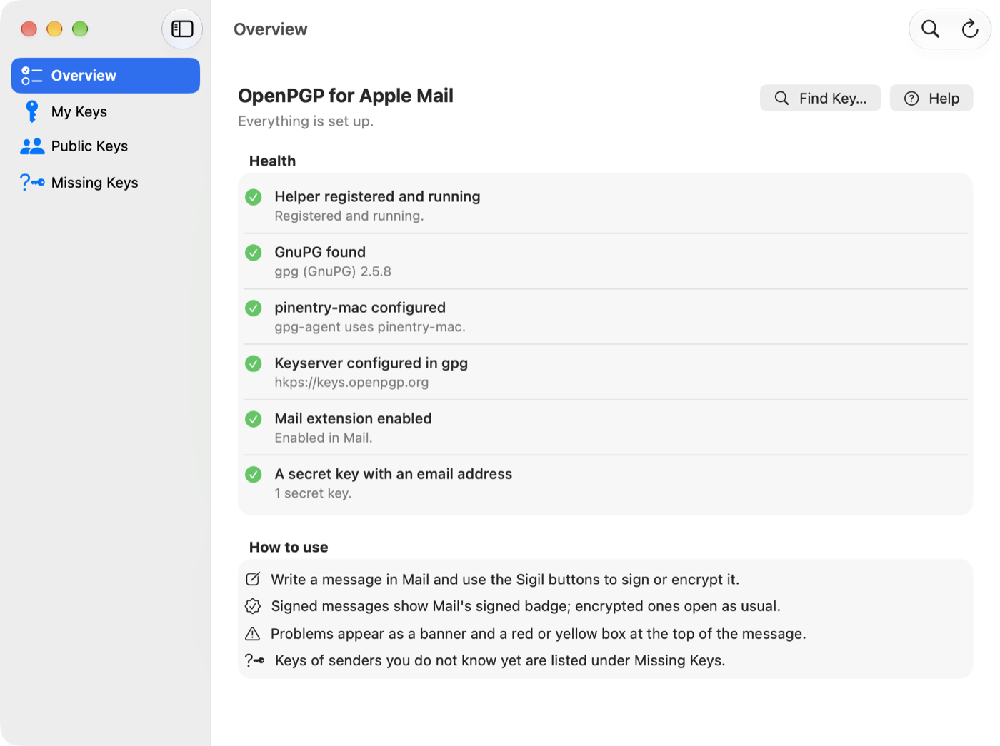
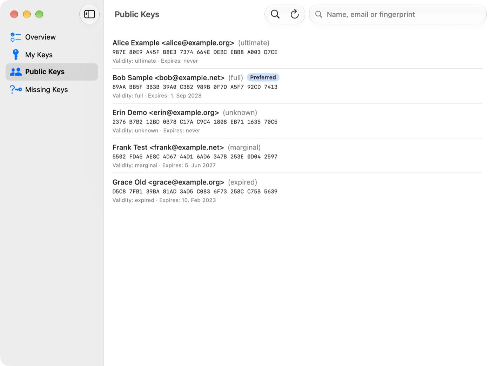
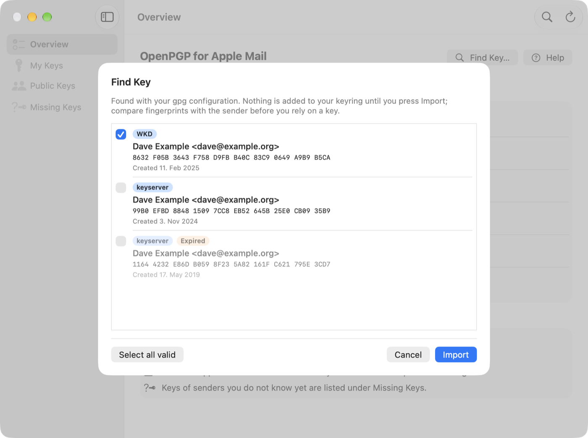
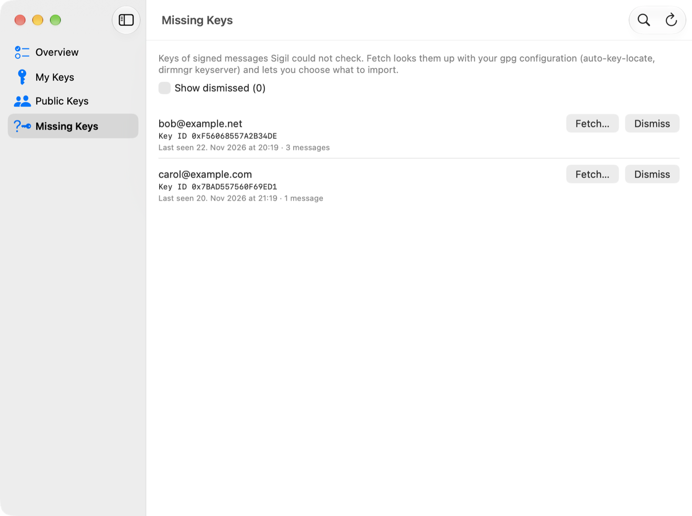
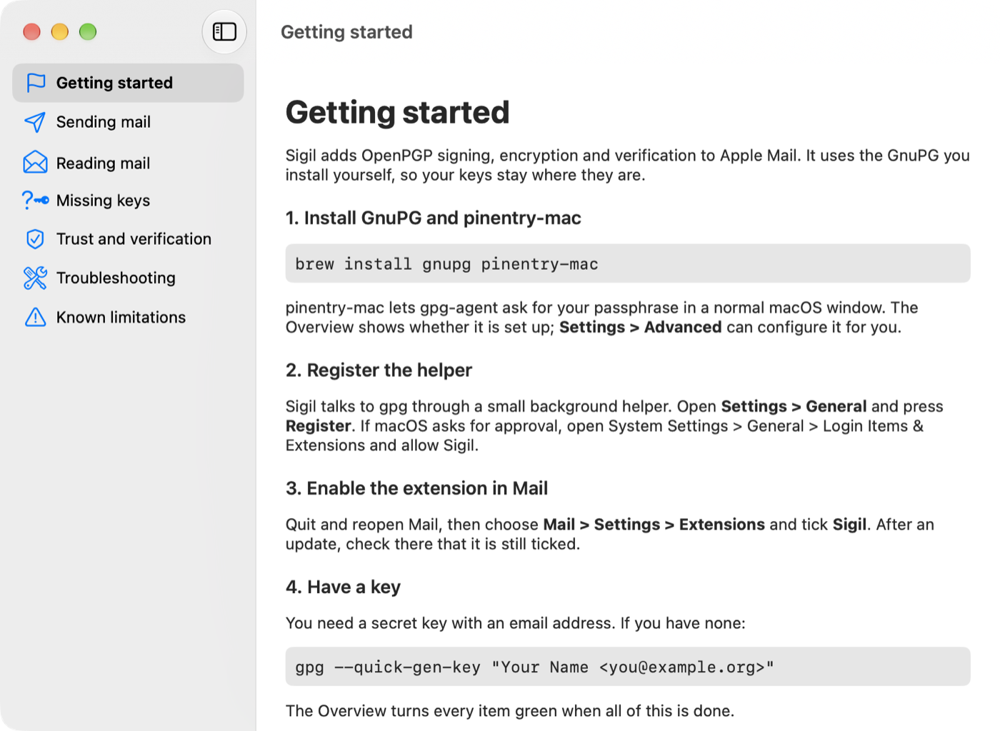

<h1 align="center">Sigil</h1>

<em>OpenPGP for Apple Mail — sign, seal, verify.</em>

  

> [!WARNING]
> Sigil is beta software. Do not rely on it for production use or for messages where a mistake would be costly. It comes without any warranty; see sections 15 and 16 of the [GPL-3.0](LICENSE).

Sigil signs, encrypts, decrypts and verifies mail in Apple Mail with OpenPGP: PGP/MIME, plus inline PGP when reading.

It uses your own GnuPG from Homebrew (your keys, trust, gpg-agent and pinentry-mac, and your keyserver configuration), through a sandboxed MailKit extension plus a small helper. There is no server and no telemetry. It is written in Swift and SwiftUI.

## Features

- Sign and encrypt from Mail's compose toggles; encrypted messages are also encrypted to yourself.
- Automatic decryption and verification when you open a message.
- Only valid signatures get Mail's signed badge; problems show a banner and a red or yellow warning box.
- Recipient keys that are not verified are marked; with several keys per address, you pick a preferred one.
- Missing Keys and Find Key fetch keys through your own gpg configuration and let you choose which to import.
- EFAIL protections: remote content is blocked and mixed content is not decrypted automatically.
- The app shows a health overview, your keys, settings and built-in help.

All features: [Usage](Docs/Usage.md).

| Public Keys | Find Key |
|---|---|
|  |  |

| Missing Keys | Help |
|---|---|
|  |  |

## Installation

Requirements: macOS 14 or newer, Xcode, a free Apple ID (Personal Team) and `brew install gnupg pinentry-mac`. There are no prebuilt downloads yet (that needs a paid Developer ID and notarization), so you build Sigil yourself:

1. Copy `Config/Local.xcconfig.example` to `Config/Local.xcconfig` and set your Team ID.
2. Quit Mail.
3. Run `scripts/install.sh`; it builds, signs and installs `/Applications/Sigil.app`.
4. Enable "Sigil OpenPGP" in Mail > Settings > Extensions.
5. Approve the helper in System Settings > General > Login Items & Extensions if asked.

Details, updating and uninstalling: [Installation](Docs/Installation.md). Sigil does not update itself; run `scripts/install.sh` again after pulling a newer version.

## Documentation

The [installation](Docs/Installation.md) and [usage](Docs/Usage.md) guides, [security and privacy](Docs/Security-and-Privacy.md), the [known limitations](Docs/Known-Limitations.md), [troubleshooting](Docs/Troubleshooting.md) and the [architecture](Docs/Architecture.md) are in [`Docs/`](Docs/). To build Sigil for development or to contribute, see [DEVELOPMENT.md](DEVELOPMENT.md).

## License

Sigil is free software: you can redistribute it and/or modify it under the terms of the GNU General Public License as published by the Free Software Foundation, either version 3 of the License, or (at your option) any later version. See [`LICENSE`](LICENSE). Not affiliated with Apple or the GnuPG project.

Copyright © 2026 Dominik Fuchß
